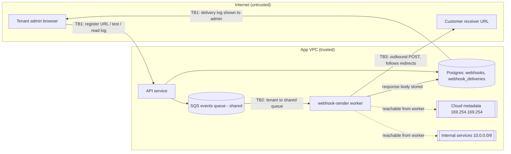

# Worked example: threat model for customer-configured outbound webhooks

**Prompt:** "We're adding outbound webhooks to our invoicing SaaS — customers
register a URL and we POST invoice events to it. Here's the design. Threat
model it before we build."

**Design summary (from the doc):** tenant admins register an endpoint URL in
settings. On `invoice.created|paid|voided`, the API enqueues an event to a
shared SQS queue. A `webhook-sender` worker (same ECS cluster and IAM role as
the API) POSTs the full invoice JSON to the URL, follows redirects, retries
up to 20 times, and stores the response body in `webhook_deliveries` so admins
can see it in a "Delivery log" UI. A single global signing secret signs
payloads (`X-Signature: sha256=...`). Endpoints can be tested with a "Send
test event" button.

Output (`THREAT_MODEL.md`), slightly abridged:

---

## Scope

**In:** endpoint registration API and UI, event enqueue, `webhook-sender`
worker, `webhook_deliveries` table and Delivery log UI, signing scheme, "Send
test event". **Out:** invoice creation itself, existing auth/SSO.

**Entry points:** `POST/PUT /api/webhooks` (tenant admin), `POST
/api/webhooks/:id/test` (tenant admin), `GET /api/webhooks/:id/deliveries`
(tenant admin), outbound HTTP from worker to arbitrary internet hosts.

## Assets (ranked)

1. Cloud credentials and internal network reach of the worker (shared IAM role with the API).
2. Other tenants' invoice data (amounts, customer PII).
3. Receivers' trust in our signature (a forged event can move money on their side).

## Actors

| Actor | Can already |
|---|---|
| Anonymous internet user | Nothing in-app; can host a URL and receive traffic. |
| Tenant admin (malicious or compromised) | Register any URL, trigger test events, read delivery log for own tenant. |
| User in another tenant | Same as above for their own tenant. |
| Insider / ops | Read queue and DB. |
| Compromised receiver | Receives payloads; returns arbitrary responses and redirects. |

## Data-flow diagram

Trust boundaries: **TB1** internet ↔ API; **TB2** per-tenant events entering a
shared queue/worker; **TB3** worker ↔ arbitrary internet host (and, because of
SSRF, potentially ↔ internal network).

## Assumptions and open questions

- Assumed the worker runs on AWS ECS with IMDS reachable and the same task role as the API (doc says "same cluster"). **Confirm.**
- Assumed delivery log renders response bodies in the admin UI. **Confirm whether as text or HTML.**
- Open: is there any per-tenant cap on endpoints or events?

## Threat table

| ID | Element / flow | STRIDE | Attack | L | I | Rating | Justification |
|---|---|---|---|---|---|---|---|
| T1 | W → TB3 | I, E | A tenant admin registers `http://169.254.169.254/latest/meta-data/iam/security-credentials/` and clicks "Send test event"; the worker fetches it and the response body (the role's AWS keys) is stored and shown in the delivery log. | H | H | Critical | Any tenant admin, one click; full-read SSRF with credentials of a role shared with the API. |
| T2 | W → TB3 redirect | I, E | Admin registers a public URL that 302s to `http://10.0.4.12:8080/admin/users`; validation on registration passes, redirect is followed. | H | H | Critical | Bypasses any registration-time check; same impact as T1. |
| T3 | Signing scheme | S | Every tenant's receiver must hold the one global secret to verify signatures, so a developer at tenant A uses it to sign forged `invoice.paid` events and sends them to tenant B's receiver. | M | H | High | Single global secret means every tenant's receiver trusts every other tenant's signer; impact is fraud on the receiver side. |
| T4 | Q → W (TB2) | D | One tenant registers a URL that hangs for 30s and triggers 50k invoice events; 20 retries each saturate the shared worker pool; other tenants' webhooks are delayed for hours. | M | M | Medium | Needs a high event volume, but free trial accounts can bulk-create invoices. |
| T5 | W → TB3 | D | A tenant points the webhook at a third party's site; our retries (20 × events) become a traffic amplifier against it. | M | L | Low | Bounded by event volume; reputational/abuse-report impact rather than data. |
| T6 | Delivery log | I, E | Receiver returns an HTML/JS body; if the log renders it as HTML in the app origin, a malicious receiver gets XSS against the tenant admin. | L | H | Medium | Depends on the rendering (open question); high impact if true. |
| T7 | Payload | I | Full invoice JSON includes the end customer's email and address; a tenant admin who registers an attacker-controlled URL exfiltrates all future invoices with no trace in app audit. | M | M | Medium | Insider/compromised-admin risk; data is the tenant's own, but there's no audit of endpoint changes. |
| T8 | Endpoint registration | R | A compromised admin account swaps the endpoint URL for a day and back; no record of who changed it or when. | M | M | Medium | Turns T7 into an undetectable incident. |
| T9 | Q | T | Insider with queue access edits a message's `tenant_id` before the worker picks it up, sending tenant A's event to tenant B's endpoint. | L | H | Medium | Requires insider access; worker trusts the message body for routing. |

## Mitigations

| ID | Mitigation | Covers | Where | Type |
|---|---|---|---|---|
| M1 | Move delivery to a dedicated egress service in an isolated subnet with no IAM role, no IMDS, and no route to `10.0.0.0/8`; all outbound via an egress proxy. | T1, T2 | Infra | Design change |
| M2 | Resolve host, reject private/loopback/link-local/metadata ranges (v4+v6), connect to resolved IP; disable redirects (treat 3xx as failure). Apply at send time, not only on registration. | T1, T2 | Egress service | Design change |
| M3 | Per-endpoint signing secret generated on registration, shown once, rotatable; sign `timestamp.body`; document a 5-minute tolerance. | T3 | API + sender | Design change |
| M4 | Per-tenant queue partitioning / fair scheduling; 5s connect + 10s total timeout; max 8 retries with exponential backoff; auto-disable endpoint after 24h of failures. | T4, T5 | Sender | Control |
| M5 | Store at most 4 KB of response body, render as escaped text only, from an API returning `application/json`. | T6 | Delivery log | Design change |
| M6 | Audit events for endpoint create/update/delete/test with actor, IP, old and new URL; email all tenant admins on endpoint URL change. | T7, T8 | API | Control |
| M7 | Worker loads endpoint by `webhook_id` from DB and checks it belongs to the event's tenant; queue messages carry IDs only, not URLs or payloads. | T9 | Sender | Design change |

## Abuse cases

1. Free-trial signup → register metadata URL → "Send test event" → read AWS keys in delivery log → assume role (T1, M1, M2).
2. Attacker hosts `https://evil.example/hook` that redirects to the internal billing admin (T2, M2).
3. Tenant A's developer copies the global secret from their own receiver config and sends signed `invoice.paid` events to a competitor's receiver (T3, M3).
4. Compromised admin adds a second endpoint pointing at a paste site, harvests a month of invoices, deletes it (T7, T8, M6).

## Residual risk

| Threat | What remains | Why accepted | Owner |
|---|---|---|---|
| T7 | A legitimate tenant admin can send their own tenant's data anywhere. | It's their data and the feature's purpose; M6 makes it visible. | Product security lead |
| T5 | Low-volume amplification against third parties within retry caps. | Caps bound it; abuse reports handled by support runbook. | Platform on-call |
| T9 | Insider with DB write access can still re-point endpoints. | Covered by existing DB access controls and audit. | Infra lead |

## Security requirements and test cases

| SR | Requirement | Threats | Test case | Tier |
|---|---|---|---|---|
| SR-1 | Webhook delivery runs in a service with no cloud credentials and no route to private ranges. | T1, T2 | From the sender task, `curl 169.254.169.254` and `curl 10.0.0.1` both fail to connect. | Before launch |
| SR-2 | Sender rejects destinations resolving to private, loopback, link-local, or metadata IPs at send time; 3xx is treated as failure. | T1, T2 | Endpoints `http://127.0.0.1.nip.io`, `http://[::ffff:169.254.169.254]`, and a public URL 302 → `10.0.0.1` each produce a "blocked destination" delivery record and no outbound connection. | Before launch |
| SR-3 | Each endpoint has its own secret; signature covers timestamp and body. | T3 | Event signed with endpoint A's secret fails verification with endpoint B's secret; event with a 10-minute-old timestamp fails reference verifier. | Before launch |
| SR-4 | Delivery log stores ≤4 KB and renders as text. | T6 | Receiver returns ``; log shows literal text; response `Content-Type` is `application/json`. | Before launch |
| SR-5 | Timeouts 5s/10s, ≤8 retries, per-tenant fair scheduling. | T4, T5 | Load test: tenant A's endpoint hangs with 10k events; tenant B's p95 delivery latency stays under 60s. | Before GA |
| SR-6 | Endpoint changes emit audit events and notify all tenant admins. | T7, T8 | Updating an endpoint URL creates an audit row with old/new URL and actor, and sends an email to each admin. | Before GA |
| SR-7 | Sender resolves endpoint from DB and verifies tenant ownership. | T9 | Queue message with mismatched `tenant_id`/`webhook_id` is dropped and logged. | Backlog |

**Priority:** SR-1 and SR-2 block launch — T1 is a one-click cloud credential
leak available to any trial account. SR-3 and SR-4 also block launch because
fixing the signing scheme after customers integrate is a breaking change.
